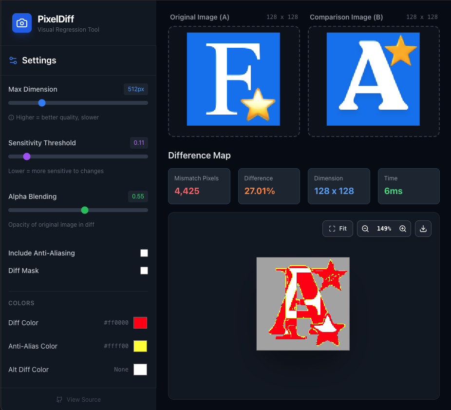

# PixelDiff

<!-- aio-desktop-badge:start -->
[](https://fbaio.org/#/desktop)
<!-- aio-desktop-badge:end -->

A visual regression testing tool for comparing images pixel by pixel. Built with React, TypeScript, and [pixelmatch](https://github.com/mapbox/pixelmatch).

## Features

- **Side-by-side comparison** - Upload two images and instantly see the differences
- **Synchronized pan & zoom** - Navigate across all views simultaneously
- **Customizable detection** - Adjust threshold, anti-aliasing detection, and color options
- **Detailed statistics** - View mismatched pixels, diff percentage, and execution time
- **Diff visualization modes** - Toggle between difference highlighting and mask mode
- **Responsive design** - Works seamlessly on desktop and mobile devices
- **Dark theme** - Eye-friendly interface for extended use

## Demo

[View live demo](https://hoangtran99.is-a.dev/pixel-diff/)

## Screenshot



## Getting Started

### Prerequisites

- Node.js (v16 or higher)
- npm or bun

### Installation

```bash
# Clone the repository
git clone https://github.com/hoangtran0410/pixel-diff.git
cd pixeldiff

# Install dependencies
npm install
# or
bun install
```

### Development

```bash
# Start the development server
npm run dev
# or
bun run dev
```

The app will be available at `http://localhost:5173`

### Build

```bash
# Build for production
npm run build
# or
bun run build
```

The built files will be in the `dist` directory.

### Preview

```bash
# Preview the production build
npm run preview
# or
bun run preview
```

## Usage

1. **Upload Images**: Drag and drop or click to upload your original image (A) and comparison image (B)
2. **Adjust Settings**: Fine-tune comparison parameters in the settings panel:
   - **Max Dimension**: Limit image size for faster processing
   - **Threshold**: Sensitivity of pixel matching (0-1)
   - **Include AA**: Detect anti-aliased pixels
   - **Alpha**: Transparency of diff overlay
   - **Colors**: Customize diff and anti-aliasing colors
   - **Diff Mask**: Toggle mask mode to show only differences
3. **View Results**: The difference map shows mismatched pixels highlighted in red (or your custom color)
4. **Navigate**: Pan and zoom across all views synchronously

## Settings

| Setting | Description | Default |
|---------|-------------|---------|
| Max Dimension | Maximum width/height for comparison (px) | 512 |
| Threshold | Matching threshold (0.0 - 1.0) | 0.1 |
| Include AA | Detect anti-aliased pixels | false |
| Alpha | Diff overlay transparency (0.0 - 1.0) | 0.1 |
| AA Color | Anti-aliasing highlight color | #ffff00 |
| Diff Color | Primary difference color | #ff0000 |
| Diff Color Alt | Alternative difference color | null |
| Diff Mask | Show only differences | false |

## Technology Stack

- **React 19** - UI library
- **TypeScript** - Type safety
- **Vite** - Build tool and dev server
- **Tailwind CSS** - Styling
- **Pixelmatch** - Image comparison algorithm
- **Lucide React** - Icons

## Project Structure

```
pixeldiff/
├── src/
│   ├── components/
│   │   ├── ComparisonView.tsx    # Diff result display
│   │   ├── ImageDropzone.tsx     # Image upload component
│   │   └── SettingsPanel.tsx     # Settings controls
│   ├── hooks/
│   │   ├── useCacheState.ts      # LocalStorage state persistence
│   │   └── usePanZoom.ts         # Pan/zoom functionality
│   ├── services/
│   │   └── pixelmatchService.ts  # Image comparison logic
│   ├── utils/
│   │   └── color.ts              # Color conversion utilities
│   ├── types.ts                  # TypeScript type definitions
│   ├── App.tsx                   # Main application component
│   ├── index.tsx                 # App entry point
│   └── index.html                # HTML template
├── package.json
├── tsconfig.json
├── vite.config.ts
└── README.md
```

## How It Works

PixelDiff uses the [pixelmatch](https://github.com/mapbox/pixelmatch) algorithm to perform pixel-by-pixel comparison of images:

1. Both images are loaded and scaled to match dimensions (respecting max dimension setting)
2. Images are drawn to canvas and pixel data is extracted
3. Pixelmatch algorithm compares each pixel, accounting for:
   - Brightness and color differences
   - Anti-aliasing detection (optional)
   - Configurable threshold for matching
4. Differences are rendered with custom colors and transparency
5. Statistics are calculated (mismatched pixels, percentage, execution time)

## Contributing

Contributions are welcome! Please feel free to submit a Pull Request.

## License

This project is open source and available under the MIT License.

## Acknowledgments

- [pixelmatch](https://github.com/mapbox/pixelmatch) - Fast pixel-level image comparison library
- [Lucide](https://lucide.dev/) - Beautiful icon set

## Author

[hoangtran0410](https://github.com/hoangtran0410) + [Gemini](https://ai.studio)

<!-- aio-desktop:start -->
### 🖥️ AIO Desktop

**EN:** Find this app and many more free tools & games in **[AIO Desktop](https://fbaio.org/#/desktop)**, a Windows/macOS-style web desktop by Social AIO. [▶ Open AIO Desktop](https://fbaio.org/#/desktop)

**VI:** Xem app này cùng nhiều công cụ, trò chơi miễn phí khác trong **[AIO Desktop](https://fbaio.org/#/desktop)**, màn kiểu Windows/macOS của Social AIO. [▶ Mở AIO Desktop](https://fbaio.org/#/desktop)
<!-- aio-desktop:end -->
